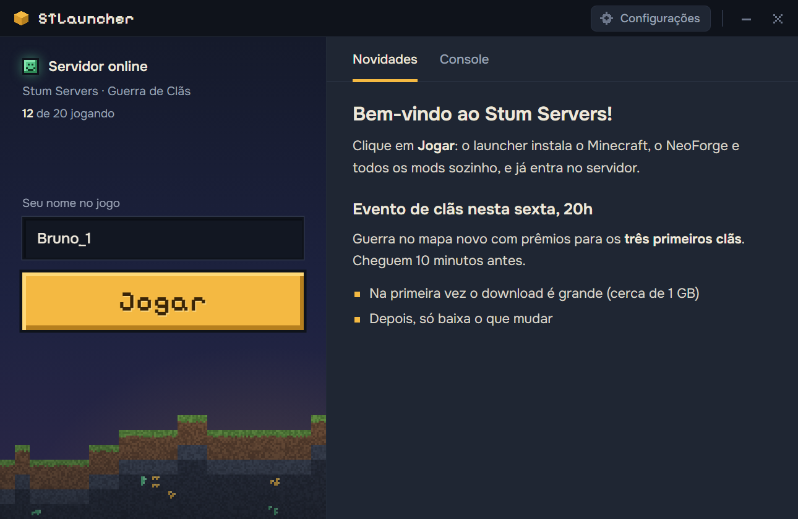
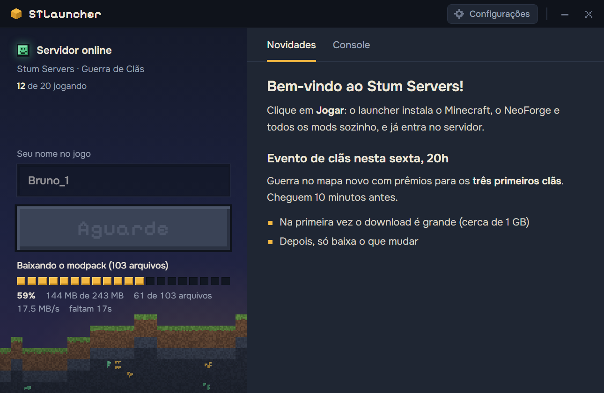
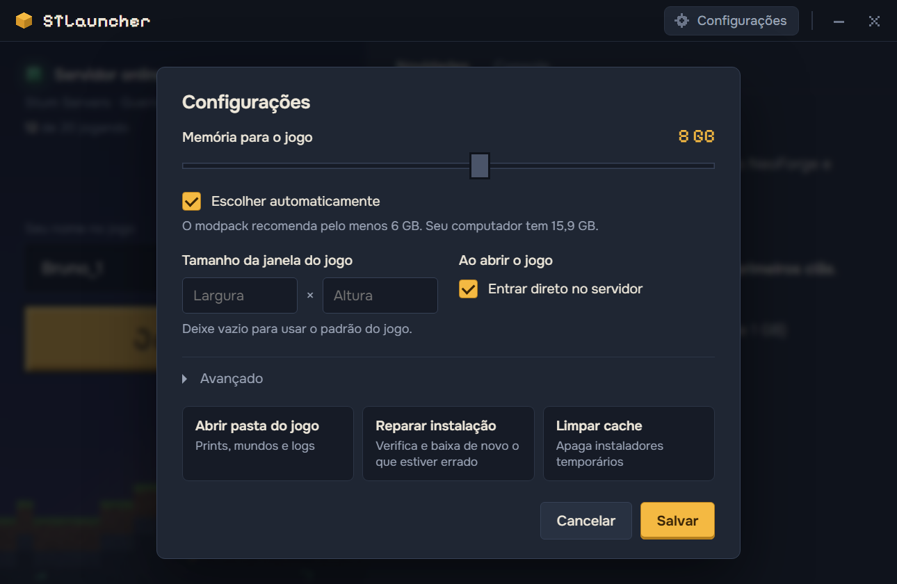
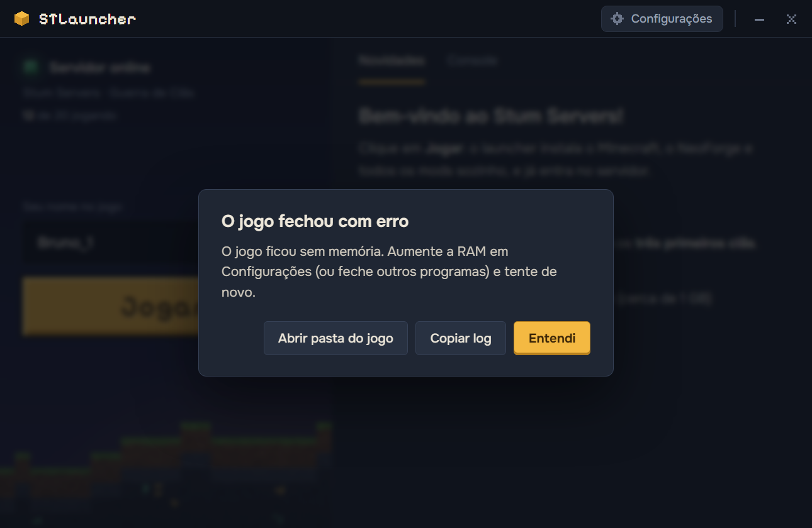

<div align="center">


<br>

[](https://github.com/stumdev/stlauncher/actions/workflows/ci.yml)
[](https://github.com/stumdev/stlauncher/actions/workflows/release.yml)
[](LICENSE)


[](CONTRIBUTING.md)

**Launcher de Minecraft para o Stum Servers: um clique instala tudo e já entra no servidor.**

[Baixar](#baixar) · [Publicar o modpack](#publicar-o-modpack) · [Contribuir](CONTRIBUTING.md) · [Changelog](CHANGELOG.md)

</div>

---

## Sobre

O STLauncher é um launcher leve para Windows feito para o servidor **Stum Servers** (Minecraft 1.21.1 com NeoForge e mais de 100 mods). O jogador digita o nome, clica em **Jogar** e o launcher instala o Java, o Minecraft, o NeoForge e o modpack, e abre o jogo já conectado no servidor.

**Para quem joga:** baixa o instalador → digita o nome → clica em Jogar. Sem conta da Microsoft, sem copiar mods, sem configurar nada. Quando o modpack muda, o launcher baixa só a diferença.

Junto vem uma **API própria** (Node + Fastify, sem banco de dados) que distribui o modpack, as notícias da tela inicial e as atualizações do próprio launcher.

## Destaques

- 🟨 **Um clique de verdade:** Java 21 (Temurin), Minecraft, NeoForge e 100+ mods instalados sozinhos, com a entrada direta no servidor ligada.
- 🔁 **Modpack sempre igual ao do servidor:** compara o sha256 de cada arquivo, baixa só o que mudou e remove de `mods/` o que saiu do pack.
- ⏯️ **Downloads que retomam:** 16 em paralelo, com verificação de hash e continuação do ponto onde pararam.
- 👤 **Contas offline:** só o nome, com o mesmo UUID que o servidor gera em `online-mode=false`, então ninguém perde inventário.
- 🛟 **À prova de leigo:** mensagens em português dizendo o que aconteceu e o que fazer (sem internet, disco cheio, antivírus, pouca RAM, crash de mod).
- 📴 **Funciona sem a API:** se o servidor de atualizações cair, abre com a última versão instalada e avisa.
- 🙂 **Status do servidor e notícias:** quem está online, mensagem do dia e avisos em Markdown direto na tela inicial.
- 🔐 **Atualiza sozinho com segurança:** o updater só aceita pacotes assinados.
- 🪶 **Leve:** `.exe` de ~4,6 MB e instalador de ~1,9 MB.

## Telas

| Início | Baixando o modpack |
|---|---|
|  |  |
| **Configurações** | **Crash com resumo em português** |
|  |  |

---

## Sumário

- [Baixar](#baixar)
- [Como funciona](#como-funciona)
- [Estrutura do projeto](#estrutura-do-projeto)
- [Rodando a API](#rodando-a-api)
- [Publicar o modpack](#publicar-o-modpack)
- [Compilando o launcher](#compilando-o-launcher)
- [Publicar uma versão nova do launcher](#publicar-uma-versão-nova-do-launcher)
- [Configuração](#configuração)
- [Testes](#testes)
- [Limitações](#limitações)
- [Roadmap](#roadmap)
- [Contribuindo](#contribuindo)
- [Licença](#licença)

## Baixar

Na página de [Releases](https://github.com/stumdev/stlauncher/releases/latest):

| Arquivo | Para quê |
|---|---|
| `STLauncher_x.y.z_x64-setup.exe` | **Recomendado.** Instala por usuário (sem administrador) e se atualiza sozinho. |
| `STLauncher_x.y.z_portable.exe` | Um `.exe` solto, sem instalar. Não se auto-atualiza. |

Requisitos: Windows 10 ou 11 (64 bits) e uns 3 GB livres. O WebView2 já vem no Windows.

> O `.exe` não tem assinatura de código paga, então o Windows pode mostrar "O Windows protegeu o computador". Clique em **Mais informações → Executar assim mesmo**.

## Como funciona

Ao clicar em **Jogar**:

1. **Procura atualizações:** baixa o manifest da API (versão do pack, do Minecraft e do NeoForge, endereço do servidor, notícias e a lista de arquivos com sha256).
2. **Java 21:** usa um já instalado ou baixa o JRE Temurin 21 do Adoptium (checksum conferido) para a pasta do launcher.
3. **Minecraft 1.21.1:** version json, client, libraries e assets direto da Mojang, com SHA-1.
4. **NeoForge:** roda o **installer oficial** em modo headless (`--installClient`), que gera o client modificado; reimplementar isso seria frágil.
5. **Modpack:** compara cada arquivo com o manifest, baixa o que falta ou mudou e remove de `mods/` o que não está no pack. Em `config/`, `resourcepacks/` e `shaderpacks/` só remove o que um pack anterior instalou, e o `servers.dat` só é sobrescrito quando o pack muda.
6. **Abre o jogo:** o launcher monta o comando sozinho (classpath, module path, argumentos da JVM e do jogo, `--quickPlayMultiplayer`) e mostra o log na aba Console. Se o jogo fechar com erro, mostra um resumo em português e o botão **Copiar log**.

Segurança do manifest: todo caminho passa por uma whitelist (`mods`, `config`, `resourcepacks`, `shaderpacks`, `servers.dat`), sem `..`, caminhos absolutos, `:` ou nomes reservados do Windows.

## Estrutura do projeto

```
stlauncher/
├── api/                    # servidor que distribui o pack (Node + Fastify)
│   ├── src/                # app.js (rotas), config.js, lib/ (manifest, paths, publish)
│   ├── bin/                # publish-pack.js, publish-launcher.js
│   ├── test/               # testes (node:test)
│   └── Dockerfile, docker-compose.yml, .env.example
├── launcher/               # app desktop (Tauri 2)
│   ├── launcher.config.json   # nome do launcher + URL da API (embutidos no build)
│   ├── index.html, src/       # interface em TypeScript puro (sem framework)
│   └── src-tauri/src/         # núcleo em Rust: download, java, mojang, neoforge, pack, launch, status...
└── docs/                   # banner, logo e capturas
```

## Rodando a API

Requisitos: **Node.js 20.12+** (ou Docker).

```bash
cd api
npm ci
cp .env.example .env        # defina ADMIN_TOKEN (16+ caracteres)
npm start                   # http://0.0.0.0:8080
```

Com **Docker** (é como roda em produção): `docker compose up -d --build`. A porta externa vem de `HOST_PORT` no `.env` e os dados ficam em `./data`.

Gerar um token: `node -e "console.log(require('crypto').randomBytes(32).toString('hex'))"`.

### Endpoints

| Rota | Descrição |
|---|---|
| `GET /api/pack/manifest` | versão do pack, MC, NeoForge, endereço do servidor, RAM mínima, notícias e `files[{path, sha256, size, url}]` |
| `GET /api/launcher/version` | versão mais nova do launcher (formato do updater do Tauri); `204` se nada publicado |
| `GET /files/<path>` | arquivos do pack, com `Range` (retomada) |
| `GET /launcher-files/<arquivo>` | instaladores do launcher |
| `POST /api/admin/publish` | (token) reescaneia os arquivos e gera o manifest; aceita `{news, serverAddress, ...}` |
| `PUT` / `DELETE /api/admin/files/<path>` | (token) envia/remove um arquivo do pack (confere `x-sha256`) |

O token vai no header `x-admin-token` (ou `Authorization: Bearer ...`). Sem CORS; limite de 120 pedidos por minuto por IP em `/api/*` (os arquivos do pack não têm limite).

### Expondo na internet

O jeito recomendado é um **Cloudflare Tunnel** (HTTPS e nenhuma porta aberta no roteador): no painel Zero Trust → Tunnels, adicione um hostname apontando para `http://localhost:<HOST_PORT>`. Atrás de proxy, use `TRUST_PROXY=true` e `PUBLIC_URL=https://seu-hostname`.

Alternativas: Caddy (`reverse_proxy 127.0.0.1:8080`) ou nginx, ou abrir a porta no roteador (HTTP puro funciona, mas prefira HTTPS).

## Publicar o modpack

Monte uma pasta com `mods/` e, se quiser, `config/`, `resourcepacks/`, `shaderpacks/` e `servers.dat`. Outras pastas são ignoradas de propósito (o comando avisa quais).

```powershell
cd api
$env:ADMIN_TOKEN = "seu-token"
node bin/publish-pack.js "D:\meu-pack" --remote https://launcher.stumservers.pro --neoforge 21.1.267 --server mc.stumservers.pro:25565
```

Ele envia **só o que mudou**, apaga o que saiu e gera o manifest. Nas próximas vezes basta a pasta e o `--remote`: NeoForge, servidor e notícias ficam salvos.

Trocar só as **notícias** (Markdown):

```powershell
node bin/publish-pack.js --remote https://launcher.stumservers.pro --news "**Evento sexta 20h!**"
# ou --news-file noticias.md
```

Outras opções: `--mc`, `--min-ram <MB>`, `--pack-version`. Veja `node bin/publish-pack.js --help`.

> A versão do NeoForge do pack precisa ser **igual** à do servidor, senão o jogo não conecta.

## Compilando o launcher

Requisitos: **Node.js 22+**, **Rust** (stable, MSVC) e **Visual Studio Build Tools** (C++).

```powershell
cd launcher
npm ci
$env:TAURI_SIGNING_PRIVATE_KEY = "$env:USERPROFILE\.tauri\stlauncher.key"
npm run tauri build
```

Saídas em `launcher/src-tauri/target/release/`: `stlauncher.exe` (portátil) e `bundle/nsis/STLauncher_<versão>_x64-setup.exe` (+ `.sig`).

Desenvolvimento: `npm run tauri dev`.

### Chave do auto-update

O updater só aceita pacotes assinados. A chave privada fica **fora do repositório** (`%USERPROFILE%\.tauri\stlauncher.key`) e a pública está em `launcher/src-tauri/tauri.conf.json` → `plugins.updater.pubkey`. **Faça backup da privada:** sem ela, os launchers instalados não recebem mais atualizações.

Para trocar: `npx tauri signer generate -w caminho\nova.key`, cole a nova `.pub` no `pubkey` e atualize o secret `TAURI_SIGNING_PRIVATE_KEY` do repositório.

## Publicar uma versão nova do launcher

1. Suba a versão em `launcher/src-tauri/tauri.conf.json`, `launcher/src-tauri/Cargo.toml` e `launcher/package.json`, e anote no [CHANGELOG](CHANGELOG.md).
2. Crie a tag: `git tag v1.0.1 && git push origin v1.0.1`. O workflow **Release** compila no Windows e publica o `.exe`, o instalador, a assinatura e o `SHA256SUMS.txt`.
3. Avise os launchers instalados:

```powershell
cd api
node bin/publish-launcher.js "STLauncher_1.0.1_x64-setup.exe" --version 1.0.1 --notes "Correções" --remote https://launcher.stumservers.pro
```

O `.sig` ao lado do instalador é lido automaticamente. Na próxima abertura, cada launcher se atualiza sozinho.

## Configuração

| O quê | Onde |
|---|---|
| Nome do launcher e URL da API | `launcher/launcher.config.json` (`name`, `apiUrl`) |
| Nome do instalador e identificador | `launcher/src-tauri/tauri.conf.json` (`productName`, `identifier`) |
| Endereço do servidor, versão do NeoForge, RAM mínima, notícias | `publish-pack` (`--server`, `--neoforge`, `--min-ram`, `--news`) |
| Token, porta, URL pública, proxy, limite de pedidos | `api/.env` (veja `.env.example`) |
| Cores do launcher | variáveis no topo de `launcher/src/style.css` |

As pastas do jogo ficam em `%LOCALAPPDATA%\<nome do launcher>\data` (dá para trocar nas Configurações): `libraries/ versions/ assets/ runtime/ game/ cache/ state/ logs/`. O jogo roda em `game/`.

## Testes

```bash
cd api && npm test                                # manifest, hash, Range, nomes com + # &, admin, rate limit
cd launcher/src-tauri && cargo test --lib         # UUID, diff do pack, comando de launch, download/retomada, ping, crash
cd launcher && node --test src/markdown.test.ts   # Markdown seguro das notícias
cd launcher/src-tauri && cargo test --lib temurin -- --ignored   # com rede: baixa o Java de verdade
```

Teste ponta a ponta (Java, Minecraft e NeoForge reais contra uma API):

```bash
cd launcher/src-tauri
cargo run --example e2e -- https://launcher.stumservers.pro C:\pasta-de-teste MeuNick prepare   # só instala
cargo run --example e2e -- https://launcher.stumservers.pro C:\pasta-de-teste MeuNick           # instala e abre o jogo
```

O CI roda os testes da API no Linux e os do launcher no Windows a cada push.

## Limitações

- Só Windows x64. O código é portável, mas no Linux falta o download automático do Java.
- O ping de status não resolve registros SRV do DNS: use `host:porta` no endereço do servidor (o jogo em si resolve SRV).
- Só a versão instalada se auto-atualiza; o `.exe` portátil precisa ser baixado de novo.
- Sem assinatura de código (Authenticode), o SmartScreen avisa na primeira execução.
- Contas offline: qualquer pessoa pode entrar com qualquer nome, então proteja o servidor com whitelist ou plugin de login.

## Roadmap

- [x] Instalação com 1 clique (Java, Minecraft, NeoForge, modpack)
- [x] Sincronização por hash, retomada de download e modo offline
- [x] Status do servidor, notícias e auto-update assinado
- [ ] Seletor de pasta nas Configurações
- [ ] Download automático do Java no Linux
- [ ] Vários modpacks/servidores no mesmo launcher

Tem uma ideia? [Abra uma issue](https://github.com/stumdev/stlauncher/issues/new/choose).

## Contribuindo

Contribuições são bem-vindas! Leia o [guia de contribuição](CONTRIBUTING.md) e o [código de conduta](CODE_OF_CONDUCT.md). Para falhas de segurança, veja a [política de segurança](SECURITY.md).

## Licença

Distribuído sob a licença [MIT](LICENSE). As fontes Onest e Pixelify Sans são distribuídas sob a [SIL Open Font License](launcher/src/fonts/).
